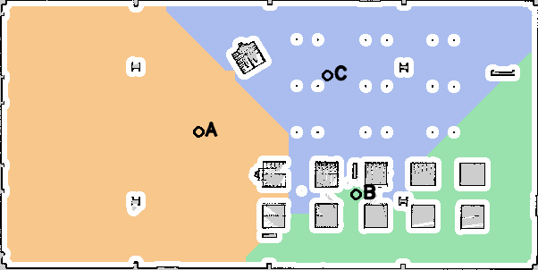

# TurtleBot 4 — Phân vùng bản đồ và điều hướng bằng giọng nói

Sử dụng lại bản đồ `depot_02.yaml` của bài trước, hiển thị ba vùng **A/B/C** trên RViz, nhận câu nói tiếng Việt bằng **Whisper** và gửi goal tuần tự cho **Nav2**.

Luồng xử lý: **microphone → Whisper → `/voice/transcript` → phân tích vùng → `/navigate_to_pose` → robot**. RViz hiển thị bản đồ, robot, vùng và đường Nav2.

## 1. Chuẩn bị terminal

Dừng phiên mô phỏng cũ, teleop, node cử chỉ hoặc chương trình gửi goal cũ trước khi mở phiên mới. Mở các terminal sau:

| Terminal | Công việc |
|---|---|
| 1 | Gazebo, bản đồ, AMCL, Nav2 và RViz |
| 2 | Kiểm tra dock, undock và trạng thái điều hướng |
| 3 | Chạy Whisper, nhận dạng từ microphone |
| 4 | Bật nghe từng câu hoặc hủy hành trình |
| 5 — tùy chọn | Mở lại RViz/Gazebo hoặc xem topic riêng |

**Chạy khối dưới đây trong mỗi terminal mới**, trước các lệnh ở những mục tiếp theo:

```bash
cd ~/tb4_ws
export TB4_LAB_DOMAIN_ID=78
source src/turtlebot4_slam_nav/scripts/env.sh
export GZ_IP=127.0.0.1
```

Tất cả terminal dùng **domain 78**, tương ứng `GZ_PARTITION=tb4_ws_lab_78`. Script nạp ROS 2 Jazzy và workspace; không cần sửa `.bashrc`.

### Build — chỉ cần khi mới lấy hoặc sửa mã nguồn

```bash
/usr/bin/python3 -m colcon build --symlink-install \
  --packages-select turtlebot4_voice_nav
source install/local_setup.bash
ros2 pkg executables turtlebot4_voice_nav
```

Nếu package `turtlebot4_slam_nav` chưa được build, thay `--packages-select` bằng `--packages-up-to` trong lệnh trên.

### Chuẩn bị Whisper — thực hiện một lần

Nếu đã có `.venv-voice` và `models/whisper-small/model.bin` thì bỏ qua:

```bash
bash src/turtlebot4_voice_nav/scripts/setup_voice.sh
```

Bước này cần Internet để tải thư viện và model. Các lượt nhận dạng sau chạy model trên máy bằng CPU/int8. Dùng `.venv-voice`, không dùng môi trường YOLO hoặc cử chỉ để chạy Whisper.

## 2. Terminal 1 — mở Gazebo, map, AMCL, Nav2 và RViz

```bash
ros2 launch turtlebot4_voice_nav voice_navigation.launch.py gui_render_engine:=ogre2
```

Giữ terminal này mở. Chờ robot và bản đồ xuất hiện; Gazebo phải ở trạng thái **Play**.

- World sử dụng: **depot**; bản đồ được lấy từ catalog `config/generated/regions.yaml`.
- Launch **đã mở cả RViz**, không cần chạy thêm một RViz nữa.
- Với bản đồ và spawn mặc định, AMCL tự khởi tạo initial pose. Không cần chọn `2D Pose Estimate` mỗi lần.
- Trên RViz: **Fixed Frame = `map`**, có nhãn A/B/C; kiểm tra LiDAR và vị trí robot phù hợp với bản đồ.
- Nếu đổi map hoặc vị trí spawn, cần xác định lại initial pose tương ứng; không tiếp tục dùng pose mặc định khi không còn khớp.

Không chạy hai launch mô phỏng đồng thời. Nếu đã có đúng world/map, AMCL và Nav2 ở domain 78, chỉ khởi chạy phần giọng nói/hiển thị bằng:

```bash
ros2 launch turtlebot4_voice_nav voice_navigation.launch.py simulation:=false
```

Lệnh này vẫn tạo `voice_navigator` và `semantic_visualizer`; chỉ dùng khi hai node này chưa chạy trong phiên hiện tại.

## 3. Terminal 2 — cho robot rời dock và chờ sẵn sàng

### 3.1. Kiểm tra dock

```bash
ros2 topic echo /dock_status irobot_create_msgs/msg/DockStatus --once
```

Nếu `is_docked: true`, chạy:

```bash
ros2 action send_goal /undock irobot_create_msgs/action/Undock '{}' --feedback
```

Chờ kết quả **`SUCCEEDED`**, rồi kiểm tra lại:

```bash
ros2 topic echo /dock_status irobot_create_msgs/msg/DockStatus --once
```

Cần thấy **`is_docked: false`**. Nếu đã rời dock thì bỏ qua lệnh undock.

### 3.2. Theo dõi trạng thái điều hướng

```bash
ros2 topic echo /voice/navigation_status --qos-durability transient_local
```

Chờ trường **`"ready": true`**. Node kiểm tra clock đang chạy, AMCL/TF, lifecycle Nav2, action server và trạng thái rời dock.

Nhấn **Ctrl+C** để dừng lệnh `echo` nếu muốn dùng terminal cho lệnh khác; thao tác này không dừng mô phỏng.

**Nếu nói khi `ready=false`, câu lệnh bị từ chối bằng `NOT_READY`. Sau khi hệ thống sẵn sàng, phải bật nghe và nói lại; câu bị từ chối không được tự chạy lại.**

## 4. Terminal 3 — chạy nhận dạng giọng nói

Dùng cấu hình đã thử trong phiên quay: **8 giây thu âm cho mỗi câu**.

```bash
./.venv-voice/bin/python -m turtlebot4_voice_nav.speech_recognition_node \
  --ros-args \
  -p model_path:="$HOME/tb4_ws/models/whisper-small" \
  -p record_seconds:=8.0
```

Chờ log **`READY`**. Lúc này model đã nạp nhưng **chưa thu microphone**. Việc thu một câu chỉ bắt đầu khi gọi `/voice/listen` ở terminal 4.

### Nếu microphone mặc định không thu được tiếng

Dừng node Whisper bằng **Ctrl+C**, sau đó xem thiết bị:

```bash
arecord -l
```

Nếu kết quả vẫn là **card 2, device 0** như trên laptop đã dùng, chạy:

```bash
./.venv-voice/bin/python -m turtlebot4_voice_nav.speech_recognition_node \
  --ros-args \
  -p model_path:="$HOME/tb4_ws/models/whisper-small" \
  -p audio_device:=plughw:2,0 \
  -p record_seconds:=8.0
```

Nếu `arecord -l` báo số card/device khác, đổi `plughw:2,0` cho đúng. Chỉ chạy **một** node nhận dạng, chọn một trong hai lệnh trên.

## 5. Terminal 4 — bật nghe và nói câu lệnh

Mỗi lần muốn nói một câu, chạy:

```bash
ros2 service call /voice/listen std_srvs/srv/Trigger '{}'
```

Sau khi terminal 3 hiện **`RECORDING`**, nói một câu rõ ràng trong khoảng thu 8 giây. Sau đó ngừng nói và chờ nhận dạng.

Phản hồi service `success=True` chỉ có nghĩa yêu cầu thu âm đã được nhận, chưa có nghĩa robot chấp nhận hoặc hoàn thành hành trình.

### Trình tự thực hiện đúng yêu cầu bài tập

**Với mỗi hàng dưới đây: gọi `/voice/listen`, đợi `RECORDING`, rồi nói câu tương ứng. Chờ `ROUTE_COMPLETED` trước khi bật nghe lệnh đi tiếp theo.**

| Lượt | Câu nói | Kết quả cần quan sát |
|---|---|---|
| 1 | **“Đi đến khu vực một.”** | Robot đến A, báo `ROUTE_COMPLETED` |
| 2 | **“Đi đến khu vực hai.”** | Robot đến B, báo `ROUTE_COMPLETED` |
| 3 | **“Đi đến khu vực ba.”** | Robot đến C, báo `ROUTE_COMPLETED` |
| 4 | **“Di chuyển từ khu vực một đến khu vực hai.”** | Robot đang ở C → đến A trước → đến B → hoàn thành |
| 5 | **“Đi đến nhà ăn.”** hoặc **“Đi đến khu vực Z.”** | Nếu transcript chứa đúng tên vùng lạ: báo `REJECTED`, không gửi goal mới |

Trong phần demo điều hướng bằng giọng nói, không dùng teleop hoặc công cụ Nav2 Goal để điều khiển robot.

### Có thể nói câu khác mẫu không?

Có, trong phạm vi các mẫu và alias đã hỗ trợ, ví dụ:

- “Đến khu vực hai.”
- “Robot hãy đi đến khu vực ba.”
- “Đi từ khu vực một qua khu vực ba rồi đến khu vực hai.”
- “Đi từ phòng A qua khu vực C rồi đến phòng B.”

A/B/C tương ứng **một/hai/ba**; transcript có chữ số **1/2/3** cũng được chấp nhận. Có thể gọi B bằng “bê”, C bằng “xê” hoặc “cê”. Đây là tên tương đương được khai báo, không phải đoán tên gần giống. “Phòng A” là cách gọi vùng A, chưa có nghĩa chương trình nhận biết đó là một phòng thật.

Chương trình phân tích theo quy tắc, chưa hiểu câu tùy ý như “Đưa tôi qua chỗ bên kia”. Nếu muốn dùng tên “phòng thí nghiệm”, cần khai báo alias đó trước ở mục 9.

Nếu đang có hành trình, lệnh đi mới bị báo `BUSY`. Một câu có vùng lạ ở bất kỳ điểm nào, ví dụ “từ A đến Z”, bị từ chối toàn bộ trước khi gửi goal. Một waypoint thất bại sẽ dừng chuỗi, không tự bỏ qua điểm đó.

## 6. Hiển thị trên RViz

RViz mở sẵn theo launch ở terminal 1. Nếu chưa có cửa sổ hoặc đã đóng RViz, mở **terminal mới**, chạy khối chuẩn bị ở mục 1, rồi chạy:

```bash
ros2 run rviz2 rviz2 \
  -d "$(ros2 pkg prefix turtlebot4_voice_nav)/share/turtlebot4_voice_nav/rviz/semantic.rviz" \
  --ros-args -p use_sim_time:=true
```

Không cần chạy lệnh này nếu RViz của phiên hiện tại vẫn mở.

Trong **Displays**, bật các mục sau và đặt **Global Options → Fixed Frame = `map`**:

| Display | Nội dung |
|---|---|
| `Map` | Bản đồ đã lưu |
| `RobotModel` | Vị trí/hướng robot |
| `LaserScan` | Các điểm quét LiDAR |
| `Amcl Particle Swarm` | Phân bố hạt AMCL |
| `Semantic regions A B C` | Ranh giới và nhãn A/B/C |
| `Requested waypoint order` | Thứ tự các đích được yêu cầu |
| `Global Planner → Path` | Đường đi do Nav2 lập kế hoạch |
| `Controller → Local Plan` | Kế hoạch cục bộ khi robot di chuyển |

Đưa chuột vào bản đồ, **cuộn lên để phóng to**, giữ **chuột giữa để kéo căn giữa**. Đường Planner là kế hoạch hiện tại, không phải vệt toàn bộ quãng đường đã đi. Ranh giới màu A/B/C cũng không phải đường robot chạy.

Bảng Navigation 2 có thể hiện `Feedback: unknown`; riêng dòng này chưa đủ để kết luận node giọng nói bị lỗi. Dùng `/voice/navigation_status` để theo dõi hành trình do node gửi.

### Ý nghĩa các trạng thái thường gặp

| Trường/sự kiện | Ý nghĩa |
|---|---|
| ASR `READY` | Model đã nạp; có thể gọi `/voice/listen` |
| ASR `RECORDING` | Đang thu microphone; bắt đầu nói |
| ASR `TRANSCRIBING` | Đang suy luận; ngừng nói và chờ |
| ASR `TRANSCRIBED` | Có văn bản nhận dạng; kiểm tra nội dung đã nghe |
| Nav `ready=true` | Robot đủ điều kiện nhận tuyến mới |
| `NOT_READY` | Chưa đủ điều kiện; sửa nguyên nhân rồi nói lại |
| `ROUTE_ACCEPTED` | Toàn bộ danh sách vùng đã được kiểm tra |
| `GOAL_ACCEPTED` / `FEEDBACK` | Nav2 đã nhận goal / đang cập nhật tiến độ |
| `WAYPOINT_REACHED` | Đã đến một đích; chuỗi có thể còn đích tiếp theo |
| **`ROUTE_COMPLETED`** | **Đã hoàn thành toàn bộ hành trình** |
| `REJECTED` | Câu lệnh hoặc tên vùng không hợp lệ; xem message |
| `GOAL_FAILED` | Goal không thành công; chuỗi dừng tại đây |
| `ROUTE_CANCELED` | Action đã kết thúc sau yêu cầu hủy |

## 7. Hủy hành trình và dừng chương trình

Để yêu cầu hủy từ terminal đã nạp môi trường:

```bash
ros2 service call /voice/cancel std_srvs/srv/Trigger '{}'
```

Chờ `ROUTE_CANCELED`. Nếu không có hành trình đang chạy, service báo không có action của node này để hủy.

Cũng có thể bật nghe rồi nói **“Dừng lại”** hoặc **“Hủy điều hướng”**. Cách này cần thời gian thu âm và suy luận; nếu cần yêu cầu hủy ngay, dùng service trên.

Khi kết thúc phiên:

1. Nếu robot còn đang đi, gọi `/voice/cancel` và chờ kết thúc action.
2. **Ctrl+C** terminal 3 để dừng Whisper.
3. Dừng các lệnh `echo`, `hz`, `tf2_echo` còn chạy.
4. **Ctrl+C** terminal 1 và chờ launch thoát; đóng các GUI mở riêng nếu có.

Đóng riêng cửa sổ Gazebo không đồng nghĩa đã dừng simulator server. Dừng launch cũ trước khi mở một phiên mô phỏng mới.

## 8. Xử lý các tình huống đã gặp

### 8.1. Whisper nghe đúng nhưng robot không chạy: `NOT_READY`

Kiểm tra dock trước, vì robot còn ở dock sẽ bị chặn điều hướng:

```bash
ros2 topic echo /dock_status irobot_create_msgs/msg/DockStatus --once
```

Nếu `true`, thực hiện undock ở mục 3. Nếu đã `false` mà vẫn chưa sẵn sàng, kiểm tra lần lượt:

```bash
ros2 lifecycle get /amcl
ros2 lifecycle get /bt_navigator
ros2 topic echo /amcl_pose --once --qos-durability transient_local
```

Hai lifecycle node cần `active`. Kiểm tra clock bằng lệnh sau; sau khi thấy timestamp tiến, nhấn Ctrl+C:

```bash
ros2 topic echo /clock
```

Kiểm tra TF rồi nhấn Ctrl+C:

```bash
ros2 run tf2_ros tf2_echo map base_link --ros-args -p use_sim_time:=true
```

Đảm bảo Gazebo đang Play và mọi terminal cùng domain 78. Sau khi `ready=true`, bật nghe và nói lại câu bị từ chối.

### 8.2. Gazebo đang chạy thì cửa sổ tự tắt: `exit code 139`

Nếu tiến trình chết trong log có **`gz sim -g`**, đó là tiến trình GUI. Khi server mô phỏng vẫn chạy, mở terminal mới, nạp môi trường theo mục 1 rồi chạy:

```bash
ros2 launch turtlebot4_voice_nav gazebo_gui.launch.py gui_render_engine:=ogre2
```

Lệnh chỉ kết nối lại giao diện, giữ nguyên phiên server và vị trí robot. Chỉ chạy khi cửa sổ chưa mở lại. Trong lúc đó có thể tiếp tục quan sát trên RViz.

Nếu server/launch cũng đã dừng, lệnh GUI riêng không khởi tạo lại robot. Khi đó cần dừng phần còn lại của phiên cũ và chạy lại từ mục 2.

Nếu muốn chạy không có GUI Gazebo để giảm tải, **dừng phiên cũ trước**, rồi thay lệnh terminal 1 bằng:

```bash
ros2 launch turtlebot4_voice_nav voice_navigation.launch.py gazebo_gui:=false
```

RViz vẫn được mở. Khi cần, kết nối GUI bằng lệnh phía trên. Chưa thể xác định nguyên nhân crash chỉ từ mã lỗi 139; đổi renderer không được coi là bảo đảm sửa mọi crash.

### 8.3. RViz báo shader `active samplers ... same texture image unit`

Nếu bản đồ, robot và nhãn A/B/C vẫn hiển thị và cập nhật thì có thể tiếp tục theo dõi; riêng thông báo shader không chứng minh Nav2 bị lỗi. `Stereo is NOT SUPPORTED` cũng không phải xác nhận mô phỏng hỏng.

Nếu bản đồ không hiện: thử tắt/bật display `Map`, kiểm tra topic `/map`, Fixed Frame `map` và TF. Nếu RViz đứng hình hoặc lỗi lặp liên tục, cần kiểm tra tiếp giao diện/driver; không bỏ qua tình trạng mất hiển thị.

### 8.4. RViz báo queue đầy hoặc timestamp cũ

Có thể có message cũ trong lúc khởi tạo, nhưng nếu cảnh báo kéo dài cần kiểm tra Play, `/clock`, TF và `use_sim_time`. Tránh chạy hai server/clock của các phiên khác nhau cùng domain. Đừng chỉ tăng queue để che việc thiếu TF hoặc sai thời gian.

### 8.5. Service `/voice/listen` chờ mãi

Chạy Whisper ở terminal 3, chờ `READY`, kiểm tra cùng môi trường/domain. Có thể dùng:

```bash
ros2 service list
ros2 node list
```

Nếu node chưa nạp được model, kiểm tra đã chạy `setup_voice.sh` và có `models/whisper-small/model.bin`.

### 8.6. Nghe nhầm hoặc từ chối câu nói

Kiểm tra transcript trước khi nói lại; đặt microphone gần hơn và giảm tiếng nền. Service bật nghe thành công không bảo đảm câu được nhận đúng. Trong phiên quay 01/11/2026, “nhà ăn” bị nghe thành “nhà anh”; cả hai đều không có trong catalog nên parser từ chối, nhưng vẫn phải ghi nhận đó là lỗi ASR.

Để xem trạng thái nhận dạng, dùng một terminal riêng:

```bash
ros2 topic echo /voice/asr_status --qos-durability transient_local
```

Để xem riêng các câu mới được publish, dùng terminal khác:

```bash
ros2 topic echo /voice/transcript
```

## 9. Bản đồ, tọa độ và đổi tên vùng



Các đích mặc định đã dùng trong phiên quay, thuộc hệ `map`:

| ID | Tên gọi tương đương | x (m) | y (m) | yaw (rad) |
|---|---|---:|---:|---:|
| A | khu vực một / khu vực 1 | -3.992 | 0.016 | 0.0 |
| B | khu vực hai / khu vực 2 | 4.808 | -3.484 | 0.0 |
| C | khu vực ba / khu vực 3 | 3.208 | 3.166 | 0.0 |

Đây là vùng chức năng được chia theo khoảng cách geodesic trên tập ô trống liên thông, sau khi loại ô có khoảng hở dưới 0,30 m. Chưa phải phương pháp tự nhận biết phòng/hành lang. Nav2 tiếp tục xử lý vật cản hiện tại khi điều hướng.

Muốn gọi A bằng tên có ý nghĩa, sửa `name` và **bổ sung** alias trong `config/generated/regions.yaml`, giữ lại các alias đang dùng, ví dụ:

```yaml
name: Phòng thí nghiệm
aliases:
  - A
  - khu vực a
  - khu vực một
  - khu vực 1
  - phòng thí nghiệm
```

Không dùng cùng một alias cho hai vùng. Dừng launch cũ rồi khởi động lại với catalog vừa sửa:

```bash
ros2 launch turtlebot4_voice_nav voice_navigation.launch.py \
  gui_render_engine:=ogre2 \
  regions_file:="$HOME/tb4_ws/src/turtlebot4_voice_nav/config/generated/regions.yaml"
```

Khi đó “Đi đến phòng thí nghiệm” chọn vùng A. Nếu sửa goal, phải đồng thời cập nhật `pixel: [cột, hàng]` tương ứng, bảo đảm thuộc đúng nhãn và đủ khoảng hở; node từ chối catalog không nhất quán.

### Chỉ tạo lại vùng khi đổi bản đồ hoặc chủ động phân vùng lại

**Không cần chạy bước này cho mỗi phiên. Lệnh sinh lại sẽ thay các đích demo hiện tại bằng đích tự động và ghi lại các file trong thư mục đầu ra.**

```bash
ros2 run turtlebot4_voice_nav segment_map \
  --map "$HOME/tb4_ws/src/turtlebot4_slam_nav/maps/depot_02.yaml" \
  --output-dir "$HOME/tb4_ws/src/turtlebot4_voice_nav/config/generated" \
  --regions 3 --clearance 0.30
```

Catalog kiểm tra fingerprint YAML/ảnh để phát hiện map bị thay đổi. Khi chuyển workspace sang máy khác, tạo lại catalog để cập nhật đường dẫn map. Nếu cần giữ nguyên bộ đích demo, lưu bản sao catalog/mask trước khi sinh lại và kiểm tra lại các đích trên map mới.

| File | Nội dung |
|---|---|
| `regions.yaml` | Tên/alias, tọa độ, nhãn vùng và fingerprint bản đồ |
| `regions_mask.npz` | Nhãn số gốc của từng ô |
| `regions_overlay.png` | Ảnh bản đồ tô màu, nhãn và vị trí đích |
| `regions_labels.png` | Ảnh màu các vùng; không thay cho mask nhãn số |

## 10. Cấu trúc mã nguồn

```text
turtlebot4_voice_nav/
├── turtlebot4_voice_nav/
│   ├── map_regions.py               # Đọc bản đồ, phân vùng, chuyển tọa độ và kiểm tra
│   ├── command_parser.py            # Văn bản → chuỗi ID vùng theo thứ tự
│   ├── speech_recognition_node.py   # Bật nghe, thu âm, Whisper và publish transcript
│   ├── voice_navigator.py           # Readiness, action tuần tự, hủy và timeout
│   └── semantic_visualizer.py       # Ranh giới và nhãn A/B/C trên RViz
├── launch/
│   ├── voice_navigation.launch.py   # Simulator, AMCL, Nav2, node mới và RViz
│   └── gazebo_gui.launch.py         # Kết nối GUI vào server còn chạy
├── config/
│   ├── voice_nav.yaml               # Goal timeout 600 s, response 15 s, tuổi TF 2 s
│   └── generated/                   # Catalog, mask và ảnh kết quả phân vùng
├── rviz/semantic.rviz               # Map, sensor, robot, vùng và đường Nav2
├── scripts/setup_voice.sh           # Môi trường Python riêng và model Whisper
├── test/                            # Kiểm tra map, parser và điều phối action
├── package.xml                      # Phụ thuộc ROS 2
├── setup.py                         # Executable và tài nguyên cài đặt
└── README.md                        # Hướng dẫn chạy
```

## 11. Video, ảnh và số liệu cho báo cáo

- [Video MP4 có âm thanh — 8 phút 39 giây](../../recordings/voice_nav_2026-11-01/turtlebot4_voice_navigation_demo.mp4).
- [Ảnh chọn lọc cho báo cáo](../../recordings/voice_nav_2026-11-01/report_images/), kèm chú thích.
- [Nhật ký và bảng kết quả phiên quay](../../recordings/voice_nav_2026-11-01/EVIDENCE.md).

Thư mục ảnh có `CAPTIONS.md` để lấy chú thích; bảng số liệu nằm trong `experiment_results.csv` cạnh `EVIDENCE.md`. Khi dùng mã báo cáo đã nhận trên Overleaf, chọn compiler **pdfLaTeX** và sửa thông tin bìa trong `thong_tin.tex`.

Các liên kết trên trỏ tới hiện vật trong workspace hiện tại; nếu sao chép riêng package thì cần sao chép kèm các thư mục tương ứng.

Phiên 01/11/2026 hoàn thành các đích A, B, C và tuyến A → B khi robot đang ở C; vùng lạ bị từ chối và không có goal mới. Đây là kết quả một phiên thử, không phải độ chính xác nhận dạng tổng quát. Hướng dẫn kiểm chứng kỹ thuật trước đó: [VALIDATION.md](VALIDATION.md).
